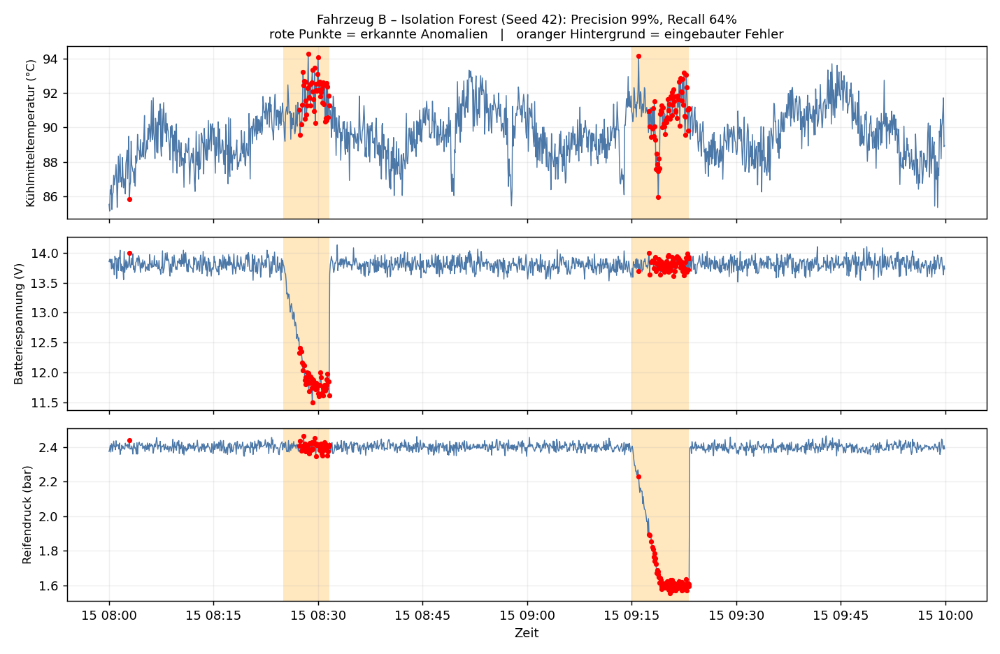
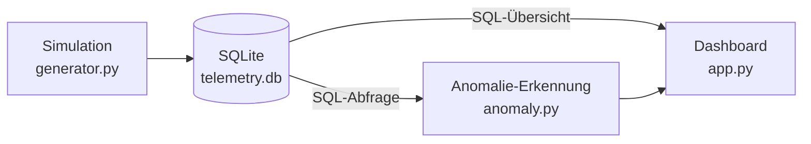

# 🚗 Fahrzeug-Telemetrie: Anomalie-Erkennung

Ein kleines Python-Projekt, das **simulierte Sensordaten von Fahrzeugen** in einer
SQL-Datenbank speichert, **Fehler automatisch erkennt** (z. B. Überhitzung, schwache
Batterie, Reifenverlust) und alles in einem **interaktiven Dashboard** zeigt.



*Beispielauswertung (Fahrzeug B, Isolation Forest, Seed 42). Rote Punkte = erkannte
Anomalien, oranger Hintergrund = Zeitfenster mit eingebautem Fehler.*

---

## Worum geht es?

Moderne Fahrzeuge liefern ständig Messwerte: Temperaturen, Spannungen, Drücke, Drehzahlen.
Wer diese Daten auswertet, kann Probleme erkennen, **bevor** das Auto liegen bleibt. Das nennt
man *Predictive Maintenance* (vorausschauende Wartung).

Echte Fahrzeugdaten sind nicht frei verfügbar. Deshalb simuliert dieses Projekt sie und baut
gezielt Fehler ein. Dadurch ist die „Wahrheit" bekannt, und man kann ehrlich messen, wie gut
die Erkennung funktioniert.

## Was kann das Projekt?

- **Daten simulieren:** 3 Fahrzeuge, je 2 Stunden Fahrt, alle 5 Sekunden ein Messwert
- **In SQL speichern:** SQLite-Datenbank mit zwei Tabellen, Fremdschlüssel, Index, `JOIN` und `GROUP BY`
- **Anomalien erkennen:** zwei Methoden im Vergleich (Grenzwert-Regeln und Isolation Forest)
- **Qualität messen:** Precision, Recall und F1-Score gegen die bekannten Fehler
- **Visualisieren:** Dashboard mit Streamlit und Plotly
- **Testen:** 12 automatische Tests mit pytest

## So hängt alles zusammen



## Schnellstart

Voraussetzung: Python 3.10 oder neuer (getestet mit 3.12).

```bash
git clone https://github.com/<dein-benutzername>/vehicle-telemetry.git
cd vehicle-telemetry

python -m venv .venv
.venv\Scripts\activate          # Windows
# source .venv/bin/activate     # macOS / Linux

pip install -r requirements.txt
streamlit run app.py
```

Der Browser öffnet sich automatisch. Beim ersten Start werden die Daten simuliert und in
`data/telemetry.db` gespeichert.

Tests ausführen:

```bash
pytest
```

## Projektstruktur

```
vehicle-telemetry/
├── app.py                  # Dashboard (Streamlit)
├── telemetry/
│   ├── generator.py        # Sensordaten simulieren, Fehler einbauen
│   ├── database.py         # SQLite: Tabellen, Speichern, SQL-Abfragen
│   └── anomaly.py          # Anomalie-Erkennung und Auswertung
├── tests/
│   └── test_telemetry.py   # automatische Tests
├── docs/
│   └── beispiel_auswertung.png
├── requirements.txt
└── pytest.ini
```

## Die Daten

| Signal | Normalbetrieb | Möglicher Fehler |
|---|---|---|
| Kühlmitteltemperatur | ca. 90 °C | `overheating`: steigt um bis zu 25 °C |
| Batteriespannung | ca. 13,8 V | `low_battery`: fällt um bis zu 2 V |
| Reifendruck | ca. 2,4 bar | `tire_leak`: fällt um bis zu 0,8 bar |
| Geschwindigkeit, Drehzahl | wechselnd, hängen zusammen | (Kontext, kein Fehlersignal) |

Ein Fehler steigt in der ersten Hälfte seines Zeitfensters an und bleibt dann bestehen. Jeder
Messwert trägt in der Spalte `fault_type` die Wahrheit (`none` oder die Fehlerart). Die
Erkennung sieht diese Spalte nicht, sie wird nur zur Auswertung benutzt.

## Die Datenbank

```
vehicles                     measurements
────────────                 ───────────────────────────
vehicle_id  (PK)  ◄───────── vehicle_id  (FK)
name                         timestamp, speed_kmh, rpm,
                             coolant_temp_c, battery_voltage_v,
                             tire_pressure_bar, fault_type
```

Beispiel: Übersicht pro Fahrzeug mit `JOIN` und `GROUP BY`

```sql
SELECT v.name, COUNT(*) AS messwerte, MAX(m.coolant_temp_c) AS max_temperatur
FROM   measurements m
JOIN   vehicles v ON v.vehicle_id = m.vehicle_id
GROUP  BY v.vehicle_id;
```

Die vollständigen Abfragen stehen in `telemetry/database.py` und werden im Dashboard angezeigt.
Werte werden immer über Platzhalter (`?`) eingesetzt, nie per String-Formatierung. Das schützt
vor SQL-Injection.

## Die Erkennung

**1. Grenzwert-Regeln:** feste Schwellen (Temperatur über 105 °C, Spannung unter 12,5 V,
Reifendruck unter 2,0 bar). Einfach und gut erklärbar.

**2. Isolation Forest:** ein Machine-Learning-Verfahren aus `scikit-learn`. Es teilt die Daten
mit vielen zufälligen Schnitten. Auffällige Messwerte liegen allein am Rand und sind schon nach
wenigen Schnitten isoliert. Feste Grenzwerte sind nicht nötig, dafür muss man den erwarteten
Anteil an Anomalien (`contamination`) schätzen.

**Bewertung:**

- **Precision:** Wie viele der Alarme waren berechtigt? *(wenig Fehlalarme = hoch)*
- **Recall:** Wie viele der echten Fehler wurden gefunden? *(wenig übersehen = hoch)*
- **F1:** Mittelwert aus beiden. Nur hoch, wenn beide hoch sind.

### Ergebnisse (Seed 42, Standardeinstellungen)

| Fahrzeug | Methode | Precision | Recall | F1 |
|---|---|---|---|---|
| A | Grenzwert-Regeln | 100 % | 71 % | 0,83 |
| A | Isolation Forest | 66 % | 77 % | 0,71 |
| B | Grenzwert-Regeln | 100 % | 71 % | 0,83 |
| B | Isolation Forest | 99 % | 64 % | 0,78 |
| C | Grenzwert-Regeln | 100 % | 72 % | 0,83 |
| C | Isolation Forest | 97 % | 63 % | 0,76 |

*Die Werte können je nach scikit-learn-Version leicht abweichen.*

**Was man daraus lesen kann:**

- Die Regeln haben **keine Fehlalarme**, übersehen aber ca. 30 % der Fehler: Am Anfang eines
  Fehlers liegt der Wert noch unter dem Grenzwert.
- Der Isolation Forest markiert **immer genau den eingestellten Anteil** (hier 8 % = 116
  Messwerte). Bei Fahrzeug A (nur 7 % echte Fehler) führt das zu Fehlalarmen, bei B und C
  (12,5 % echte Fehler) werden Fehler übersehen. Die Schätzung von `contamination` ist also
  entscheidend.
- In dieser Simulation sind die Fehler einfach, deshalb reichen feste Grenzwerte schon gut aus.
  Ob ein Machine-Learning-Verfahren bei subtileren Fehlern oder zusammenhängenden Signalen
  Vorteile bringt, wurde hier nicht untersucht.

## Grenzen dieses Projekts

- Alle Daten sind **simuliert**. Echte Fahrzeugdaten (z. B. vom CAN-Bus) sind unordentlicher.
- Die Fehler sind einfach und haben eine feste Form. Reale Defekte sind vielfältiger.
- Dass die „Wahrheit" bekannt ist, gibt es nur in der Simulation. In der Praxis müsste man
  Fehler erst von Experten markieren lassen.
- Es ist ein Lernprojekt, kein Produktivsystem.

## Ideen zum Weiterbauen

- Die Messwerte über eine **REST-API** (FastAPI) entgegennehmen statt direkt zu speichern
- Alles in einen **Docker**-Container packen
- **Zeitreihen-Merkmale** nutzen (gleitender Mittelwert, Änderungsrate) und Methoden vergleichen
- Ein Modell **pro Fahrzeug** trainieren und neue Daten damit bewerten
- **GitHub Actions** einrichten, die bei jedem Push automatisch `pytest` ausführt
- Mit einem **öffentlichen Datensatz** statt Simulation testen

---

*Unabhängiges Lernprojekt mit simulierten Daten, keine Verbindung zu einem Fahrzeughersteller.*
